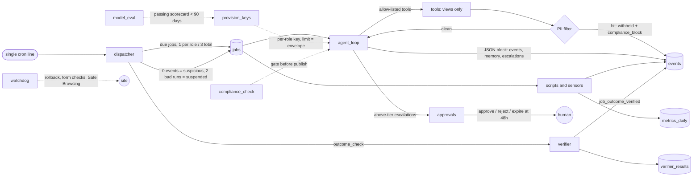

# governed-agent-ops

**Running AI agents in production without losing sleep.** A reference
implementation of the governance layer around a team of role agents: outcome-verified
scheduling, budgets enforced at the API key, a PII firewall on every tool
result, eval-gated model selection, compliance rules as data, and a human
approval queue that never treats silence as a yes.

Everything runs offline: `make demo` and `make test` need no API keys and no
network. The example business is **Acme Lending**, a fictional consumer-loan
lead-generation site.

## The problem

Scheduled agents fail quietly. A cron job exits 0 and writes nothing. An agent
reports "done" with no effect anywhere. A model invents a statistic, calls a
tool it was never meant to have, repeats a customer's email it saw in a tool
result, or overspends because the budget lives in a spreadsheet. A "please
approve" message sits unanswered and the system goes ahead anyway.

This repo is the set of mechanisms that made those failures visible and
non-default in a real multi-agent deployment.

## Architecture



| Module | What it guarantees |
|---|---|
| [`dispatcher/`](dispatcher/dispatcher.py) | One cron line runs everything in `jobs`. A run that exits 0 but writes zero events is `suspicious`, not `ok`. Each job's outcome is judged by the Verifier, and the verdict is itself the success event. Two consecutive non-ok runs auto-disable the job. |
| [`runtime/agent_loop.py`](runtime/agent_loop.py) | Tool-calling loop with a per-role tool allow-list, max turns and wall timeout. The final message must contain a parseable JSON block (events, memory updates, escalations) or the run is an error. Cost comes from the provider's generation record, not an estimate. A 402 is recorded as `budget_exhausted`. |
| [`runtime/pii_filter.py`](runtime/pii_filter.py) | Every tool result is scanned before the model sees it. A hit withholds the whole result and logs a `compliance_block` event. This is the second barrier; the first is that agents can only read allow-listed views. |
| [`budget/provision_keys.py`](budget/provision_keys.py) | One inference key per role with a spend limit equal to its monthly envelope. Enforcement is at the key, so a role cannot under-report its spend. A role whose model lacks a passing eval does not get a key. |
| [`evals/model_eval.py`](evals/model_eval.py) | Families F1 fabrication, F2 tool-calling, F3 authority, F4 role quality, F5 PII leakage, F6 consistency, F7 cost/latency. **Cost never affects pass**; it only chooses among passing models. |
| [`compliance/`](compliance/compliance_check.py) | Rules are versioned YAML ([`rules/core.yaml`](compliance/rules/core.yaml)). Regex, "required pattern" and custom handlers run first with no model. Only judgment rules reach an LLM, with the artifact text alone. An unevaluated judgment rule fails closed. |
| [`approvals/approvals.py`](approvals/approvals.py) | Above-tier actions wait for an explicit `approved`. Non-sticky items get one reminder and expire at 48h, never executed. Sticky items never expire and re-escalate on a 24/24/12/12h ladder, alternating approvers. |
| [`routing/lead_router.py`](routing/lead_router.py) | Shadow mode by default. In code: no consent means no routing; no buyer outside its licensed states; the SSN only to an `ssn_required` buyer with a contract; ping payloads carry no identity; going live needs an env flag **and** an approved Tier-2 row. |
| [`verifier/`](verifier/verify.py) | "Proves effects, not execution." Declarative checks (`sql_fresh`, `sql_count`, `file_fresh`, `http`, `json_field`, `shell`), no LLM, one result row per check, exit 1 on any hard failure. Grace periods are dated (`soft_until`) so they expire on their own. |
| [`watchdog/watchdog.py`](watchdog/watchdog.py) | Outcome checks with safe remediation: service restart, nginx rollback to the last config that actually served 200s, headless-browser form-render check, injected-script scan, Safe Browsing status, lead-flow check. Alerts dedupe until resolved. All host effects go through a pluggable `Probes` object (mocked by default). |
| [`roles/<role>/CHARTER.md`](roles/) | Mandate, authority tier, "must never", KPIs read from sensors the agent cannot write, and a kill criterion. `role.json` holds model, fallback (a different vendor) and tool allow-list. Tiers are defined in [`roles/TIERS.md`](roles/TIERS.md). |
| [`schema/ddl.sql`](schema/ddl.sql) | Postgres DDL: jobs, job_runs, events, verifier_results, approvals, budgets, model evals, routing tables and the agent-readable views. No data. |

## Design rules

1. **A job that causes nothing has failed.** Status comes from effects in the
   database, not exit codes.
2. **The auditor shares no code with the audited.** The Verifier is
   deterministic, has no LLM, and writes its own results so its liveness is
   checkable too.
3. **Budgets are enforced where the money is spent:** at the API key.
4. **PII never reaches a model**, even when a view regresses. Two independent
   barriers, because one gets widened by accident.
5. **Models are hired on measured behaviour.** No passing scorecard, no key.
   Cost is a tiebreaker, never a pass criterion.
6. **Deterministic first, model only for judgment**, and judgment fails closed.
7. **Silence is a "no".** Nothing above an agent's tier executes without an
   explicit approval.
8. **Risky automation starts in shadow mode** and leaves it only through a
   human-approved trail that the Verifier also asserts.
9. **Agents are judged on sensors they cannot write.**

## Run it

Requires Python 3.11+. No third-party packages are needed for the demo.

```bash
make demo      # or: python3 demo/run_demo.py
make test      # needs pytest
make scan      # gitleaks + compliance gate self-check
```

What the demo does, all offline against a fresh SQLite file in `var/`:

1. Seeds synthetic leads, buyers, metrics, budgets and seven jobs.
2. Qualifies each scheduled role's model and fallback with the eval harness
   (mock models), plus a deliberately sloppy candidate that fails F1, F2, F3,
   F5 and F6. The scorecard is written to `var/MODEL_SCORECARD.md`.
3. Provisions spend-capped keys per role on a mock gateway.
4. Runs the dispatcher. Expected outcome:
   - `seo.scan_pages` exits 0 and writes nothing, so it is marked **suspicious**
   - `nurture.sequence_send` fails twice and is **auto-suspended**
   - `paid.bid_review` has a $0 envelope; its key returns 402, so it is **budget_exhausted**
   - the operator agent reads a regressed view and the **PII filter withholds it**;
     it also tries an undeclared `send_email` tool, which is **denied**
   - the lead router makes **shadow decisions only** (zero live sales)
5. Stages a watchdog incident (broken nginx config, dead form): nginx is rolled
   back to the known-good snapshot and the dead form raises an alert.
6. Runs the Verifier: the two broken jobs fail their outcome checks.
7. Jumps 49 hours ahead: the operator's unanswered Tier-2 request **expires
   and is never executed**.

Individual components have CLIs too, for example:

```bash
python -m compliance.compliance_check --file page.html --type page
python -m evals.model_eval --model vendor-a/large --roles compliance,finance
python -m evals.model_eval --report
python -m verifier.verify --dry-run
python -m approvals.approvals --escalate
python -m routing.lead_router --report
python -m watchdog.watchdog --mode liveness
```

To use a real model, set `LLM_PROVIDER=openrouter` and the per-role keys from
`.env.example`. To use Postgres, set `DATABASE_URL=postgresql://...`, install
`psycopg`, and apply `schema/ddl.sql` (or `docker compose up`).

## Tests

`pytest` covers each guarantee: suspicious-on-zero-events, auto-suspension,
concurrency limits, tool allow-list denial, PII withholding, JSON-contract
enforcement, 402 handling, key refusal for unqualified models, every eval
family (including that cost never changes the verdict), each compliance rule
and fail-closed judgment, the approval ladder and expiry, the router's consent,
licensing and SSN gates, every Verifier runner and dated grace period, the
watchdog's rollback and alert dedupe, and an end-to-end demo run.
`tests/test_dataset_hygiene.py` fails the build on any non-fictional phone
number, any non-`example.com` email, any IP literal, or any scrub-list term.

CI runs the tests on Python 3.11 to 3.13, runs the demo, and runs gitleaks.

## Production context

This is a de-branded extraction of a governance layer that ran a team of role
agents (operator, compliance, finance, SEO, writer, nurture, revenue, paid,
authority, plus the Verifier) for a lead-generation business, replacing a set
of ad-hoc cron jobs. Measured in production:

- **4,486 ok / 6 suspicious / 2 failed** dispatcher runs, with **4 automatic
  suspensions**
- **673 model-eval runs** gating which model may run which role
- a Verifier with **72 outcome checks, 86.9% passing**. The Verifier exists to
  surface the failing share, not to hide it.

## What was simplified

- **Storage.** Production ran on Postgres with separate read-only and
  read-write agent roles and DB grants on the views. Here the demo and tests
  use SQLite; the Postgres DDL and adapter are included but the test suite does
  not run against a live Postgres.
- **Models.** The demo and tests use scripted mock models. Model ids in
  `roles/*/role.json` are placeholders (`vendor-a/large`, ...); the scorecard
  numbers the demo prints describe the mocks, not any real model. The
  OpenRouter client is a small stdlib implementation, not the SDK.
- **Verifier.** The production set had 72 checks over many jobs; this repo
  ships a representative sample of each kind plus three domain invariants.
- **Watchdog.** Real host probes exist (`SystemProbes`) but are untested here;
  the demo and tests use `MockProbes`. Database-credential drift checks and
  CMS integrity checks from the original were dropped.
- **Approvals.** Production posted to a chat channel and was decided by reply;
  here notifications go to stdout or an optional webhook and decisions are made
  through the CLI.
- **Sensors.** One sample sensor (`sensors/health_sensor.py`); the original
  fed search, analytics, revenue, cost, email and backlink metrics.
- **Lead buyers** are mocks. The marketplace adapter keeps the original rule
  that an unknown expected value means "no bid", never a guessed one.
- **Compliance rules** were generalised from real incidents; they are examples
  for a finance-marketing site, not legal advice.
- **Eval golden sets** are regenerated synthetic data.

## License

MIT. See [LICENSE](LICENSE).
